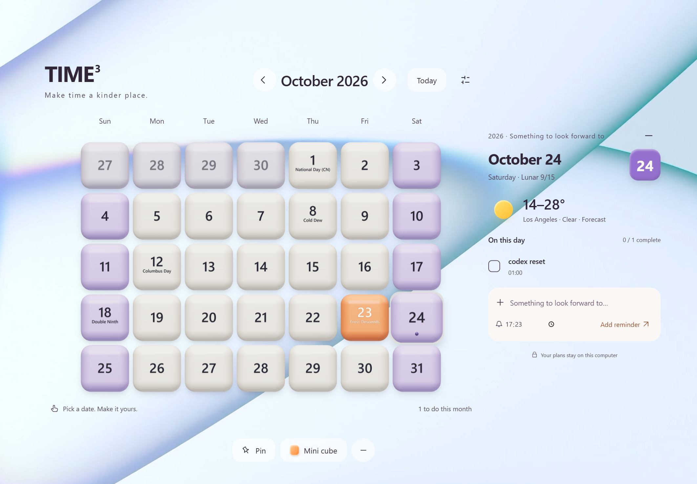

# TIME³ — Desktop 3D Calendar

A tactile Windows desktop calendar, with a little reminder cube that rolls along the taskbar and bounces into view. 

## Download

[Download TIME³ 1.6.0 for Windows x64](https://github.com/lzhhenr/TIME3/releases/download/v1.6.0/TIME3-v1.6.0-win-x64.zip) · [Latest release](https://github.com/lzhhenr/TIME3/releases/latest)

Extract the ZIP to a writable folder and open **TIME3.exe**. This version uses **Tauri + Microsoft Edge WebView2**, with a download of about 2 MB. It remains a desktop application and opens its own windows. A shared WebView2 Runtime is required; it is not bundled in the ZIP.

English is the default for new users. Switch between English and Chinese in Settings. Existing saved language choices are preserved.

Close the main window to keep reminders running in the tray. Right-click the tray icon to toggle the floating cube or quit. Fully quitting stops reminders. No installer or automatic startup is configured.

## Features

- Rounded 3D date blocks in two shapes and six palettes: butter yellow, rose pink, lavender, monochrome, jade green, and Klein blue.
- Cream weekdays, matching weekend colors, and a fixed warm orange for today.
- Chinese holidays, US federal holidays, and the 24 solar terms below date numbers. Labels do not describe adjusted working days.
- Local reminders, rolling or gentle notifications, sound effects, and optional window pinning.
- A draggable floating cube with edge hiding and hover reveal; toggle it off from the tray menu.
- Stretch reminders every 30/60 minutes, eye breaks every 20/30 minutes, and an optional five-hour codex reminder. Click Got it or close the reminder to restart its timer.
- English/Chinese, transparent backgrounds, text contrast, and window placement settings.
- Xiamen weather by default; system location is optional and disabled by default.

## Portable data

Records are stored beside the executable:

~~~text
TIME3.exe
data/
  calendar-state.json   # reminders and settings
  wellness-state.json   # health reminder timers
  WebView2/             # local WebView profile/cache
~~~

On first launch with no portable records, the app copies existing records from the previous Tauri data folder (%APPDATA%/TIME3-Tauri), or the older Electron folder (%APPDATA%/TIME3). Original files are retained and existing portable records are not overwritten.

**For updates, quit the running app, replace the EXE, and keep data.** To move or back up the app, quit it and copy the entire folder. Release downloads contain no personal records or test profiles.

Reminders use the Windows system clock. The app cannot display reminders while shut down or asleep; on restart or wake it catches up on eligible reminders from the preceding 24 hours. Unacknowledged health reminders remain pending.

## Build

Windows x64, Node.js 22, Rust stable MSVC, Microsoft C++ Build Tools, and Windows SDK are required.

~~~sh
npm ci --ignore-scripts
npm run tauri:build
~~~

The EXE is generated at src-tauri/target/release/time3-tauri.exe. The Tauri Windows workflow builds portable artifacts from main or tauri-webview2. Personal data, build output, and dependencies are excluded from Git.

The previous Electron implementation is retained in electron/ for reference; npm start and npm run package run/build that edition. The published 1.6.0 download uses Tauri and WebView2.

## Validation

Compilation and automated build checks run in GitHub Actions. Interactive validation of the recent changes is being performed by the project owner. Standard fullscreen-window behavior does not imply support for exclusive fullscreen games or the Windows secure desktop.

## Licenses

Tauri, WebView2, Three.js, lunar-javascript, and other dependencies retain their respective licenses. See THIRD_PARTY_NOTICES.md and LUNAR-LICENSE.md. The repository owner has not specified a separate project license.

Design by NEXT Studio
